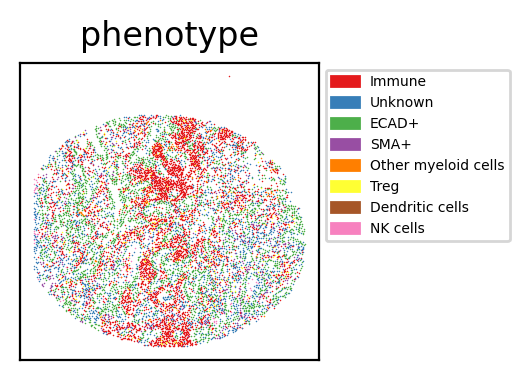
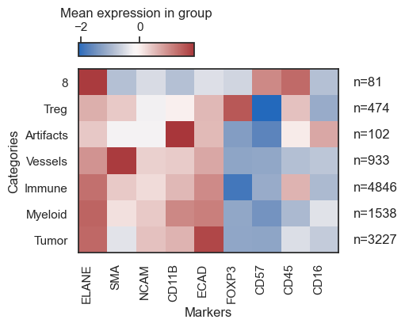
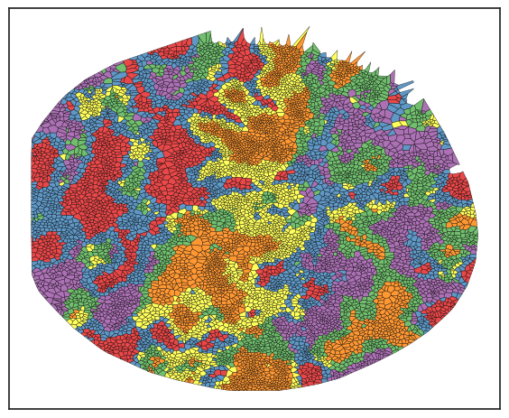
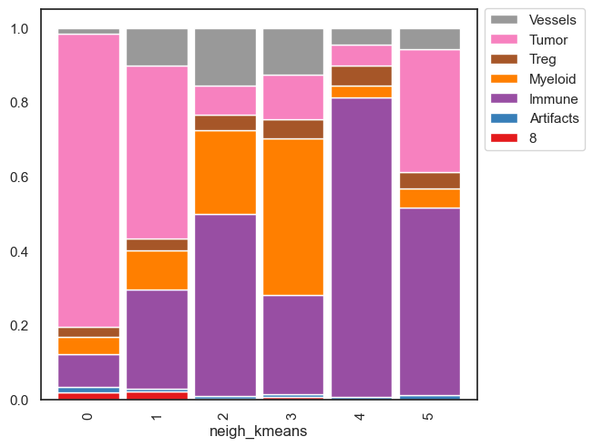
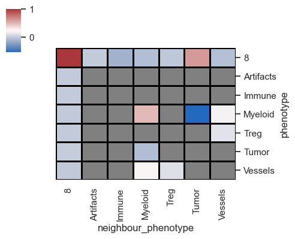

<picture>
  <source media="(prefers-color-scheme: dark)" srcset="assets/visual-abstract-dark.svg">
  
</picture>

<h1 align="center">Spatial Omics Analysis with Scimap</h1>

<p align="center">
  Cell phenotyping, cellular neighborhoods and cell-cell interactions in highly multiplexed tissue imaging, built on the Scimap framework
</p>

<p align="center">
  
  
  
  
  
</p>

<p align="center">
  <a href="#overview">Overview</a> &nbsp;·&nbsp; <a href="#results">Results</a> &nbsp;·&nbsp; <a href="#notebooks">Notebooks</a> &nbsp;·&nbsp; <a href="#phenotyping-workflow-snippet">Phenotyping snippet</a> &nbsp;·&nbsp; <a href="#how-to-run">How to run</a>
</p>

---

## At a glance

| **11,201** | **9** | **8** | **4** | **1,000** |
|:---:|:---:|:---:|:---:|:---:|
| segmented cells | protein markers | gated phenotypes | recurrent cellular neighborhoods | permutations per interaction test |

> **Take-home:** manual gating and unsupervised Leiden clustering agree on the tumor, immune and stromal compartments of the tissue. Building on those labels, neighborhood and permutation analyses reveal four recurrent cellular neighborhoods and which cell types preferentially sit next to each other.

## Skills demonstrated

| Area | Evidence in this repository |
|---|---|
| **Spatial proteomics** | Processing of MCMICRO single-cell quantification tables from highly multiplexed imaging into AnnData |
| **Cell phenotyping** | Manual and GMM gating, marker rescaling and hierarchical prior-knowledge phenotyping, cross-checked against Leiden clustering |
| **Spatial statistics** | Radius-based neighborhood counts, spatial LDA, k-means meta-clustering, spatial distances, permutation-based interaction tests and proximity scores |
| **Image-aware analysis** | Interactive gating and ROI drawing in napari, with Voronoi and spatial scatter visualizations |
| **Python** | Scimap, AnnData, Scanpy, pandas, plotly and matplotlib |

## Overview

This repository contains a Python workflow for **spatial proteomics**: analyzing highly multiplexed imaging data at single-cell resolution with the [Scimap](https://github.com/labsyspharm/scimap) framework. It uses Scimap's demonstration dataset (an MCMICRO exemplar image), converts the segmented cell table into an `AnnData` object, classifies every cell from its marker intensities, and then asks how those cell types are arranged and interact in tissue space.

**Capabilities**

- Automated download and ingestion of the Scimap demo data (MCMICRO format)
- Manual gating in napari and hierarchical, prior-knowledge cell phenotyping
- Unsupervised Leiden clustering as an independent check on the gated phenotypes
- Regions of interest (ROIs) with cell-type composition and fold-change comparisons
- Spatial neighborhood analysis (radius-based counts and spatial LDA)
- Cell-cell interaction, distance, proximity-score and aggregation analyses

## Results

### Cell phenotypes

| Gated phenotype | Cells |
|---|:---:|
| Immune (CD45+) | 4,746 |
| Epithelial (ECAD+) | 3,015 |
| Unknown | 2,278 |
| Smooth muscle (SMA+) | 602 |
| Regulatory T cells (FOXP3+) | 282 |
| Other myeloid cells | 193 |
| NK cells | 66 |
| Dendritic cells | 19 |

Leiden clustering (resolution 0.3) gives a consistent picture: 4,846 immune, 3,227 tumor, 1,538 myeloid, 933 vessel and 474 Treg cells, plus small artifact clusters.

<p>
  
  
</p>

### Cellular neighborhoods

Counting phenotypes within an 80-pixel radius of every cell and clustering those profiles identifies neighborhoods, which are then merged into four recurrent cellular neighborhoods (RCN1 to RCN4).

<p>
  
  
</p>

### Cell-cell interactions

Permutation testing (1,000 permutations) compares how often each pair of phenotypes are neighbors against chance, which highlights preferred and avoided partners.



## Notebooks

| Notebook | What it covers |
|---|---|
| [`SciMap_Cell_Phenotyping_script.ipynb`](SciMap_Cell_Phenotyping_script.ipynb) | Data download and AnnData conversion, Leiden clustering, napari gating, prior-knowledge phenotyping, ROIs, fold changes and marker correlations |
| [`SciMap_Cell_neighbourhood_Analysis_script.ipynb`](SciMap_Cell_neighbourhood_Analysis_script.ipynb) | Radius-based neighborhood counts, k-means meta-clusters, recurrent cellular neighborhoods and spatial LDA |
| [`SciMap_Spatial_Analysis_script.ipynb`](SciMap_Spatial_Analysis_script.ipynb) | Spatial distances, permutation-based interaction tests, proximity scores, aggregation and similarity search |

## Phenotyping workflow snippet

The core of the phenotyping step rescales marker intensities, defines a hierarchical gating strategy, and maps the resulting phenotypes back to spatial coordinates.

```python
import scimap as sm
import pandas as pd

# 1. Preprocessing: Rescale data to standardize marker intensities
# This allows for consistent gating (e.g., setting a universal gate at 0.5)
adata = sm.pp.rescale(adata, gate=0.5)

# 2. Define the Hierarchical Gating Strategy
# Structure: Parent -> Child -> Marker -> Polarity (pos/neg)
phenotyping_gates = pd.DataFrame({
    'Unnamed: 0': ['all', 'all', 'all', 'Immune', 'Immune', 'Immune', 'Other myeloid cells'],
    'Unnamed: 1': ['ECAD+', 'Immune', 'SMA+', 'NK cells', 'Other myeloid cells', 'Treg', 'Dendritic cells'],
    'ECAD':       ['pos',  '',       '',     '',         '',                    '',     ''],
    'CD45':       ['',     'pos',    '',     '',         '',                    '',     ''],
    'SMA':        ['',     '',       'pos',  '',         '',                    '',     ''],
    'CD57':       ['',     '',       '',     'allpos',   '',                    '',     'allneg'],
    'CD16':       ['',     '',       '',     'allpos',   '',                    '',     'allneg'],
    'CD11B':      ['',     '',       '',     'neg',      'pos',                 '',     ''],
    'FOXP3':      ['',     '',       '',     '',         '',                    'pos',  '']
})

# 3. Run Phenotyping
adata = sm.tl.phenotype_cells(adata, phenotype=phenotyping_gates, label="phenotype")

# 4. Visualization
# Map the identified phenotypes back to spatial coordinates
sm.pl.spatial_scatter(adata, color='phenotype', s=2)

adata = sm.tl.phenotype_cells(
    adata, 
    phenotype=phenotyping_gates, 
    gate=0.5, 
    label="phenotype"  # Column name for results in adata.obs
)
```

## How to run

```bash
pip install scimap "napari[all]" PyQt5 plotly
jupyter notebook SciMap_Cell_Phenotyping_script.ipynb
```

Run the notebooks in the order listed above, since each one loads the `AnnData` object saved by the previous one. The napari steps (gating and ROI drawing) open an interactive viewer window.

## Repository structure

```
├── SciMap_Cell_Phenotyping_script.ipynb
├── SciMap_Cell_neighbourhood_Analysis_script.ipynb
├── SciMap_Spatial_Analysis_script.ipynb
├── assets/
│   ├── visual-abstract-*.svg   # Visual abstract (light and dark)
│   └── figures/                # Figures exported from the notebook outputs
└── LICENSE
```

## License

Released under the [MIT License](LICENSE). The demonstration data belong to the Scimap project.
